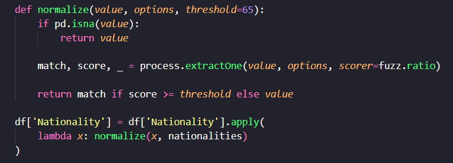
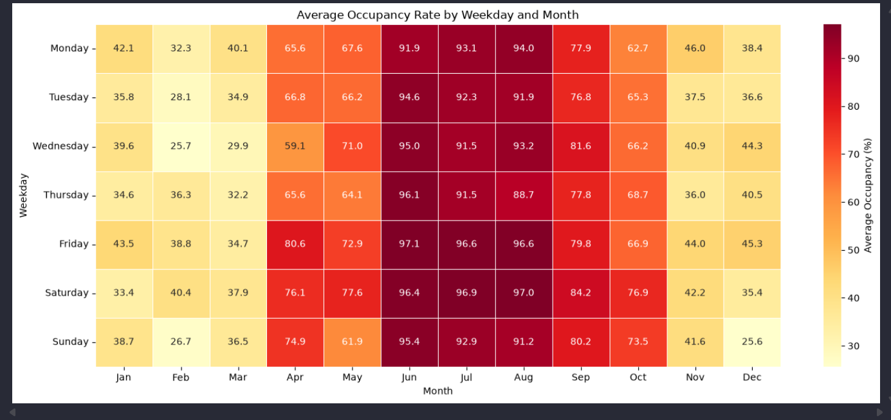
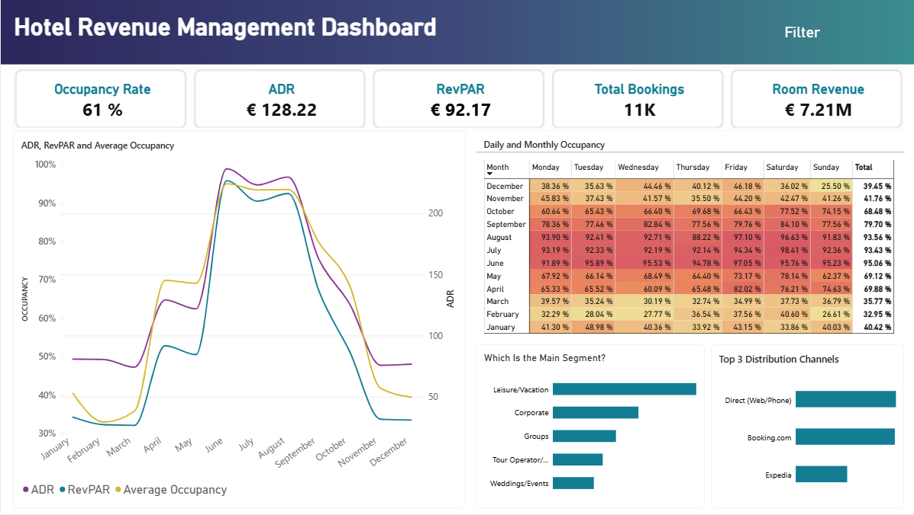

# Hotel Playa Serena — Revenue Management Analysis

A fictional hotel Revenue Management project focused on **data cleaning, exploratory analysis and business intelligence**.

The project simulates the workflow of a Revenue Management Analyst, from preparing and validating a messy dataset to analysing hotel performance and building an interactive Power BI dashboard.

> **Note:** This project uses a completely fictional and synthetic hotel dataset.

---

## Project Overview

The analysis focuses on:

- Hotel seasonality and performance
- Occupancy, ADR and RevPAR
- Booking behaviour and lead time
- Length of stay
- Market segments
- Distribution channels
- Events and ADR
- Cancellation patterns
- Data quality and cleaning

---

## Data Cleaning

The original dataset contains several data quality issues, including inconsistent categorical values, missing values, incorrect data types and formatting inconsistencies.

The cleaning process was performed using **Python, Pandas and RapidFuzz**.

---

## Exploratory Data Analysis

The cleaned dataset was analysed to identify patterns in hotel performance, demand, booking behaviour and seasonality.

The analysis was performed using **Python, Pandas, Matplotlib and Seaborn**.

---

## Power BI Dashboard

An interactive Power BI dashboard was created to visualise the main Revenue Management KPIs and allow users to explore the data through filters and slicers.

**[View the interactive Power BI Dashboard →](https://app.powerbi.com/view?r=eyJrIjoiNTdlMGY0YjQtNjVkNC00ZmQ5LTliYWQtYjBhMWE4MGI0ZDI2IiwidCI6IjcxYmIzNDU4LWQ3NWYtNDcxNi1hNWNiLTY0N2NkYWNiYzBhZiIsImMiOjh9)**

---

## Tools

**Data Analysis:** Python · Pandas · NumPy · Matplotlib · Seaborn · RapidFuzz · Jupyter Notebook

**Business Intelligence:** Power BI · Power Query · DAX

**Data:** CSV · Excel

---

## Full Project

For the complete documentation, dataset, data cleaning process, exploratory analysis and detailed findings:

**[View the complete project →](./data_cleaning_project/)**

---

## Author

Marina Gallego

**Marina**  
Hospitality Management student interested in **Revenue Management, Data Analytics and Business Intelligence**.
