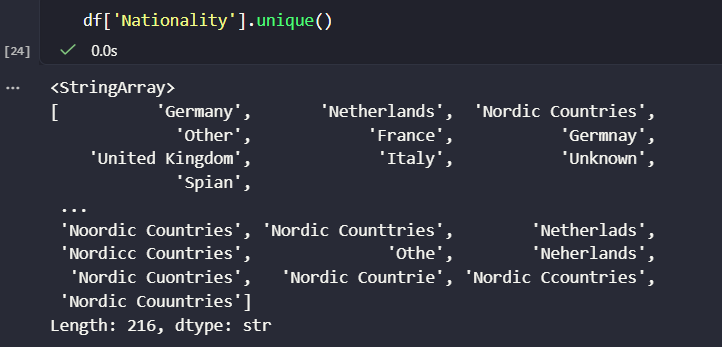

# Hotel Playa Serena - Revenue Management Analysis

A data cleaning and exploratory analysis project based on a fictional hotel reservation dataset, with a focus on Revenue Management and hotel performance indicators such as **ADR, Occupancy and RevPAR**.

The project simulates the workflow of a Revenue Management Analyst: starting with a deliberately messy dataset, cleaning and validating the data, analysing booking and demand patterns, and presenting the results through Python and Power BI.

> **Note:** This is a completely fictional and synthetic dataset. It does not represent data from any real hotel.

---

## Project Overview

The objective of this project is to explore how hotel performance and booking behaviour change throughout the year and across different demand segments.

The analysis focuses on:

* Seasonality and hotel performance
* Occupancy, ADR and RevPAR
* Booking lead time
* Length of stay
* Market segments
* Distribution channels
* Events and their relationship with ADR
* Cancellation patterns

The project also highlights limitations in the dataset and avoids interpreting simulated relationships as real-world causal effects.

---
## Dataset

The dataset contains **11,462 individual reservations** for a fictional **4-star beach hotel with 200 rooms in Mallorca**, covering one full year.

It includes:

### Revenue Management indicators

* ADR
* Occupancy
* RevPAR
* Room revenue

### Reservation data

* Booking ID
* Booking date
* Arrival date
* Departure date
* Lead time
* Length of stay
* Distribution channel
* Market segment
* Room type
* Rate plan
* Cancellation status
* Walk-In status
* Nationality

### Demand context

* Season
* Day of week
* Weekend indicator
* Event type
* Event name

### Hotel capacity

* Rooms available
* Rooms sold

### Data generation

The dataset was synthetically generated with assistance from **Claude (Anthropic)**, based on a predefined hotel scenario including the hotel type, location, seasonality, events and Revenue Management variables.

The dataset was intentionally designed to contain common data quality problems found in real-world datasets.

---

## Data Cleaning

The original dataset contained several inconsistencies that were identified and corrected using Python.

The cleaning process included:

* Removal of irrelevant columns and duplicates
* Type conversion for dates and numerical variables
* Standardization of categorical values
* Correction of typographical inconsistencies using **RapidFuzz**
* Detection and treatment of unrealistic values and outliers
* Missing value treatment
* Validation of the final cleaned dataset

The cleaned dataset was then used for the exploratory analysis and Power BI dashboard.




---

## Exploratory Data Analysis

The exploratory analysis was performed in **Python using Pandas, Matplotlib and Seaborn**.

The main areas analysed were:

### Seasonality

Occupancy, ADR and RevPAR show a strong seasonal pattern, with the highest values concentrated during the summer months and considerably lower performance during Low Season.

### Occupancy and ADR

High Season reaches very high occupancy levels, while ADR increases substantially compared with Low and Medium Season. The analysis also shows a wider distribution of ADR values during High Season.

### Booking Behaviour

Lead time and length of stay were analysed by season and market segment. High Season is associated with longer stays and earlier bookings, while Low Season contains more short and last-minute stays.

### Market Segments

Leisure/Vacation is the largest segment, followed by Corporate and Groups. The analysis also explores differences in booking behaviour between segments.

### Events

Days with events have a higher average ADR than days without events in the simulated dataset. However, the effect varies significantly depending on the type of event.

### Distribution Channels

Direct bookings and Booking.com have very similar booking volumes, while Expedia ranks third. The dataset does not include commission costs, so channel profitability cannot be evaluated.

### Cancellations

Cancellation rates vary across market segments, but the analysis suggests that these differences are strongly influenced by the seasonal distribution of each segment.


> The detailed analysis, visualizations and supporting calculations are available in the [Jupyter Notebook](data_cleaning_project/Notebooks/data_cleaning.ipynb).

---

## Power BI Dashboard

An interactive **Power BI dashboard** was created to provide a visual overview of the hotel's performance.

[**View the interactive Power BI Dashboard**](https://app.powerbi.com/view?r=eyJrIjoiNTdlMGY0YjQtNjVkNC00ZmQ5LTliYWQtYjBhMWE4MGI0ZDI2IiwidCI6IjcxYmIzNDU4LWQ3NWYtNDcxNi1hNWNiLTY0N2NkYWNiYzBhZiIsImMiOjh9)

The dashboard includes:

* Occupancy
* ADR
* RevPAR
* Revenue
* Booking volume
* Lead time
* Length of Stay
* Type of Room
* Walk-In
* Cancellation Rates
* Rate Plan
* Market segment
* Distribution channel
* Seasonality
* Event analysis
* Interactive filters and slicers

The dashboard is designed to complement the Python analysis by allowing the user to interactively explore the main hotel performance indicators.

**Dashboard preview:**


---

## Key Findings

The main findings from the simulated dataset are:

* **Strong seasonality:** Occupancy, ADR and RevPAR increase significantly during High Season.
* **High summer occupancy:** June, July and August operate close to the simulated maximum occupancy level.
* **Higher ADR in High Season:** Median ADR increases from approximately **€75.93 in Low Season** to **€224.30 in High Season**.
* **Longer stays:** High Season has longer average stays, which helps explain why it has fewer individual reservations despite higher ADR.
* **Lead time:** High Season bookings have longer lead times, although this is strongly influenced by how the synthetic dataset was generated.
* **Events:** Concerts and sporting events show the highest ADR values among the different event types.
* **Distribution channels:** Direct and Booking.com have almost identical booking volumes.
* **Cancellations:** Differences in cancellation rates between segments appear to be strongly influenced by seasonality.
* **No clear relationship between lead time and cancellation** was identified in the dataset.
* **No meaningful relationship between ADR and distribution channel** was identified.

---

## Limitations

Because the dataset is synthetic, the results should be interpreted as an analytical exercise rather than as real hotel performance.

Main limitations include:

* The dataset is fictional and synthetically generated.
* Lead time is strongly determined by arrival season, which can create unrealistic differences between market segments.
* No unique customer identifier is available, preventing customer loyalty or repeat-guest analysis.
* No competitor pricing data is available.
* No distribution-channel commission data is available, limiting profitability analysis.
* No historical booking snapshots are available, limiting genuine pickup and booking-curve analysis.
* Observed relationships should not automatically be interpreted as causal relationships.

These limitations are important when interpreting the results and were considered throughout the analysis.

---

## Tools & Technologies

**Data Cleaning and Analysis**

* Python
  * Pandas
  * NumPy
  * Matplotlib
  * Seaborn
  * RapidFuzz
  * Jupyter Notebook

**Business Intelligence**

* Power BI
  * Power Query
  * Dax Measures
  * KPI Cards
  * Buttons and Bookmarks for Page Navigation
  * Interactive Slicers for Filtering
  * Interactive Dashboards
  * Map Visualization

---

## Repository Structure

```
data_cleaning_project/
│
├── data/
│   ├── hotel_data.py
│   ├── hotel_playa_serena_bookings_dirty.csv
│   ├── hotel_playa_serena_clean_bookings.csv
│   └── hotel_playa_serena_clean_spanish.xlsx
│
├── images/
│   ├── data_correction.png
│   ├── data_visualization.png
│   ├── data_quality_issues.png
│   └── power_bi_dashboard.png
│
├── notebooks/
│   └── data_cleaning.ipynb
│
├── hotel_dashboard.pbix
│
└── README.md
```

| File                                      | Description                            |
| ----------------------------------------- | -------------------------------------- | 
| `hotel_data.py`                           | Data Generation                        |
| `hotel_playa_serena_bookings_dirty.csv`   | Initial Dataset                        |
| `hotel_playa_serena_clean_bookings.csv`   | Final Cleaned Dataset                  |
| `hotel_playa_Serena_clean_spanish.csv`    | Dataset with original Spanish values   |
| `data_correction.png`                     | Data Correction Image                  |
| `data_quality_issues.png`                 | Data Quality Issues Image              |
| `data_visualization.png`                  | Data Visualization Image               |
| `power_bi_dashboard.png`                  | Power BI image                         |
|`data_cleaning.ipynb`                      | Data Cleaning and Exploratory Analysis |
| `hotel_dashboard.pbix`                    | Data Visualization                     |
| `README.md`                               | Project documentation                  |

---

## Author

**Marina Gallego**

Hospitality Management student at EHIB, with an interest in **Revenue Management, Data Analytics and Business Intelligence**.
